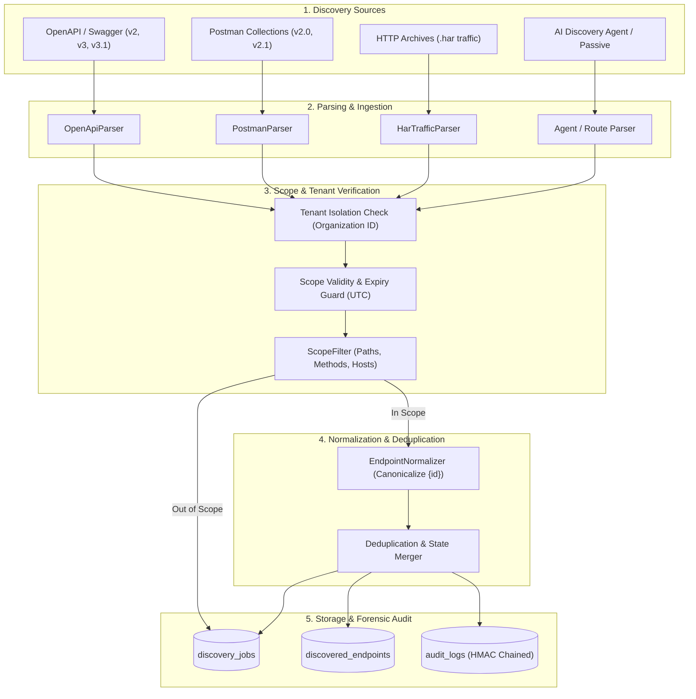
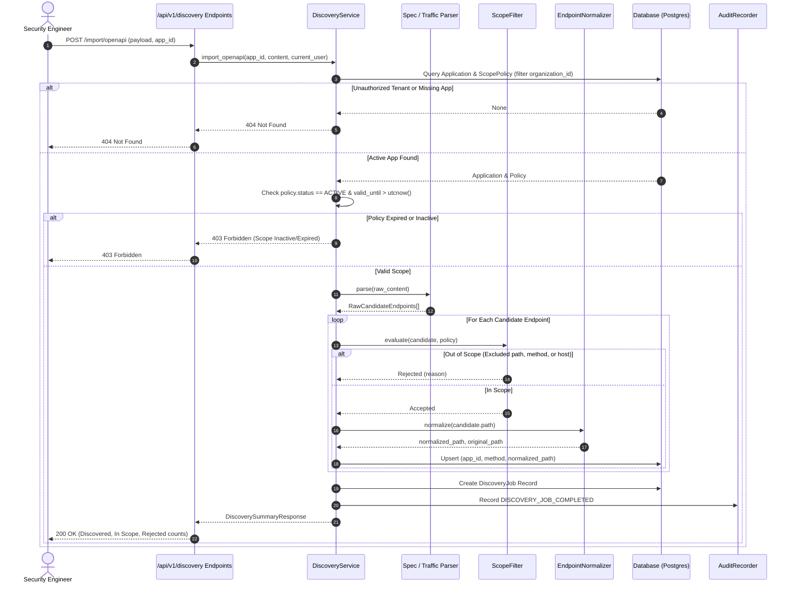

# PHANTOM-X | Member 1 — Feature 2: API Endpoint Discovery
## Discovery Subsystem Architecture

- **Author**: Member 1 (Application Intelligence)
- **Module**: Application Intelligence & Security Discovery
- **Feature**: Feature 2 — API Endpoint Discovery
- **Status**: Documented & Verified
- **Date**: 2026-11-12

---

## 1. System Overview

The API Endpoint Discovery subsystem forms the reconnaissance and attack-surface management engine of PHANTOM-X. It ingests multi-format documentation and recorded network traffic, subjects all prospective attack surfaces to rigorous scope verification, normalizes parameterized routes into canonical representations, merges duplicate observations into rich parameter schemas, and guarantees multi-tenant isolation.

---

## 2. Ingestion & Filtering Sequence

The sequence diagram below details how candidate endpoints are evaluated before any persistent mutation:

---

## 3. Canonical Path Normalization Algorithm

Dynamic URL paths in modern RESTful applications contain varied path parameter conventions. The `EndpointNormalizer` applies deterministic transformations to avoid inventory explosion:

1. **Path Sanitation**:
   - Strips protocol, domain, port, URL hash, and URL query strings.
   - Cleans duplicate slashes (`//api//v1//` -> `/api/v1`).
   - Ensures strict leading slash.
2. **Dynamic Segment Identification**:
   - **Numeric IDs**: Matches integer path segments (e.g. `/accounts/12345/statements`) and converts to `/accounts/{id}/statements`.
   - **UUIDs/GUIDs**: Matches standard 32-hex or 8-4-4-4-12 hyphenated UUID patterns (e.g. `/orders/550e8400-e29b-41d4-a716-446655440000`) and normalizes to `/orders/{id}`.
   - **Framework Tokens**: Standardizes Express/Flask style parameters (`:userId`, `<user_id>`) into canonical OpenAPI syntax `{user_id}`.
3. **Evidence Preservation**:
   - The concrete observed path is recorded in `raw_metadata["original_path"]`.
   - Additional distinct sightings are appended to `raw_metadata["observed_paths"]`.

---

## 4. Scope Safety Engine

The `ScopeFilter` strictly enforces legal boundary rules defined during Feature 1:

1. **Host Boundary Check**:
   - Host is extracted from candidate URLs (in OpenAPI servers or HAR requests).
   - If a host is present, it must match the registered `target_url` domain or exist within `target_hosts`. External third-party calls (e.g., Google Analytics, Stripe SDK, CDN scripts) are discarded.
2. **Permitted Path Check**:
   - The normalized path must start with at least one prefix declared in `permitted_paths` (default `["/"]` covers all application endpoints).
3. **Excluded Path Override**:
   - Any path matching a prefix in `excluded_paths` (e.g. `/admin`, `/auth/logout`, `/internal/metrics`) is rejected, taking absolute precedence over permitted paths.
4. **Allowed Method Check**:
   - The HTTP method (`GET`, `POST`, `PUT`, `DELETE`, `PATCH`, `HEAD`, `OPTIONS`) must be present in `allowed_methods`.
5. **Passive Execution Guard**:
   - The discovery subsystem executes zero live fuzzing or active exploits. All discovery actions parse static specifications, analyze passive HTTP traffic logs, or query read-only endpoints.

---

## 5. Deduplication & State Merging Strategy

When an application is analyzed through multiple iterations or diverse sources (e.g., first an OpenAPI spec, followed by a live HAR recording), the system unifies findings:

- **Primary Identity**: Unique index across `(application_id, method, path)`.
- **Parameter Merging**:
  - Parameters are identified by `(name, location)` (e.g., `user_id` in `path` or `filter` in `query`).
  - Descriptions, types, and schema validations from documented sources are enriched with real-world observed values from traffic logs.
- **Response Code Union**:
  - Response status codes from documentation (`200`, `400`) are combined with runtime observed codes (`201`, `401`, `500`) into a unified set.
- **Provenance Tracking**:
  - Endpoints preserve their origin tag (`openapi`, `postman`, `har`, `passive`) and primary provenance (`documented`, `imported`, `observed`).
  - Multi-source observation is maintained in `raw_metadata["sources"]`.

---

## 6. Multi-Tenant Isolation & Audit Trail

- **Data Access Layer**: All queries filter strictly by `Application.organization_id == current_user.organization_id`.
- **Cryptographic Audit Logs**:
  - Ingestion events emit `DISCOVERY_JOB_CREATED`, `DISCOVERY_JOB_COMPLETED`, and `DISCOVERY_JOB_FAILED`.
  - Manual inventory purges emit `ENDPOINT_DELETED`.
  - Every event is recorded in the append-only `audit_logs` table with SHA256/HMAC chained signatures.

