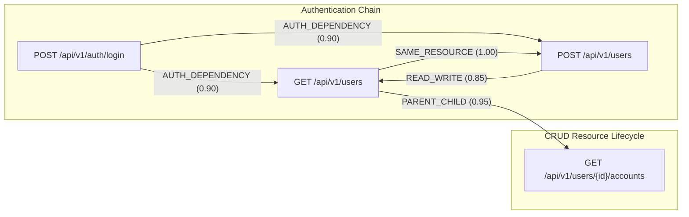

# Feature 3: API Inventory & Mapping — Relationship Mapping Design

**Member 1: Application Intelligence**  
**Module:** PHANTOM-X Application Intelligence  
**Feature:** Feature 3 — API Inventory & Mapping  
**Date:** November 12, 2026  

---

## 1. Rationale for API Relationship Modeling

In modern penetration testing and vulnerability analysis, individual endpoints cannot be evaluated in total isolation. Security flaws frequently emerge from **state interactions, multi-step transaction chaining, broken object-level authorization (BOLA/IDOR), and missing prerequisite authentication**.

The Relationship & Dependency Mapping module establishes an operational graph between endpoints that models:
1. **Prerequisite Chains**: What endpoint must be called first to acquire state or authorization tokens (e.g. `POST /auth/login` -> `GET /api/v1/users`).
2. **Lifecycle Transitions**: How entities are created, retrieved, modified, and purged (`POST /users` -> `GET /users/{id}` -> `DELETE /users/{id}`).
3. **Parameter Inheritance**: How outputs from one API call (e.g. `account_id`) feed into subsequent endpoints.

---

## 2. Relationship Taxonomy

The system defines 7 canonical relationship types:

| Relationship Type | Description | Directionality | Provenance Default |
| :--- | :--- | :--- | :--- |
| **`SAME_RESOURCE`** | Two endpoints operate on the same logical entity (e.g. `GET /users` and `POST /users`). | Bidirectional | `DOCUMENTED` |
| **`PARENT_CHILD`** | Hierarchical nesting where the target route is a child entity under the source entity. | Source -> Target | `DOCUMENTED` |
| **`READ_WRITE`** | A state-modifying endpoint (`POST`, `PUT`, `DELETE`) alters state queried by a read endpoint (`GET`). | Source -> Target | `INFERRED` |
| **`AUTH_DEPENDENCY`** | An endpoint provides credentials, tokens, or sessions required by secured endpoints. | Source -> Target | `INFERRED` |
| **`SHARED_PARAMETER`** | Endpoints that share identical business identifier parameters (e.g. `org_id`, `tenant_id`). | Bidirectional | `DOCUMENTED` |
| **`SHARED_SCHEMA`** | Endpoints that accept or return the same schema model definitions. | Bidirectional | `DOCUMENTED` |
| **`WORKFLOW_CANDIDATE`** | Multi-step transaction transitions (e.g., Cart Checkout -> Payment Authorization). | Source -> Target | `INFERRED` |

---

## 3. Provenance & Evidence Model

Every edge in the dependency graph carries explicit provenance tracking:
- **`OBSERVED`**: The sequence or correlation was directly observed in recorded HTTP traffic (HAR logs, live proxy captures).
- **`DOCUMENTED`**: Explicitly stated in the API specification (OpenAPI `links` or Postman test scripts).
- **`INFERRED`**: Deduced via heuristic static analysis (e.g. method semantics, matching path parameters, category rules).

### Confidence Scoring
- `DOCUMENTED`: `0.95 - 1.0` (Explicitly verified from developer metadata).
- `OBSERVED`: `0.90 - 0.95` (Verified through actual execution traces).
- `INFERRED`: `0.70 - 0.90` (Statistical heuristic derived from naming conventions and HTTP semantics).

---

## 4. Deduplication & Storage Architecture

In a large API surface, generating relationships can produce duplicate edges if re-run multiple times.

### Deduplication Matrix:
The database enforces uniqueness on:
```sql
CONSTRAINT uq_endpoint_relationship UNIQUE (
    application_id,
    source_endpoint_id,
    target_endpoint_id,
    relationship_type
)
```

When `rebuild_inventory_mappings()` is executed:
1. Relationships are computed in-memory across the endpoint set.
2. In-memory deduplication filters out duplicate `(source, target, type)` tuples.
3. Existing relationships for the application are queried.
4. Missing edges are inserted in a single atomic transaction.



