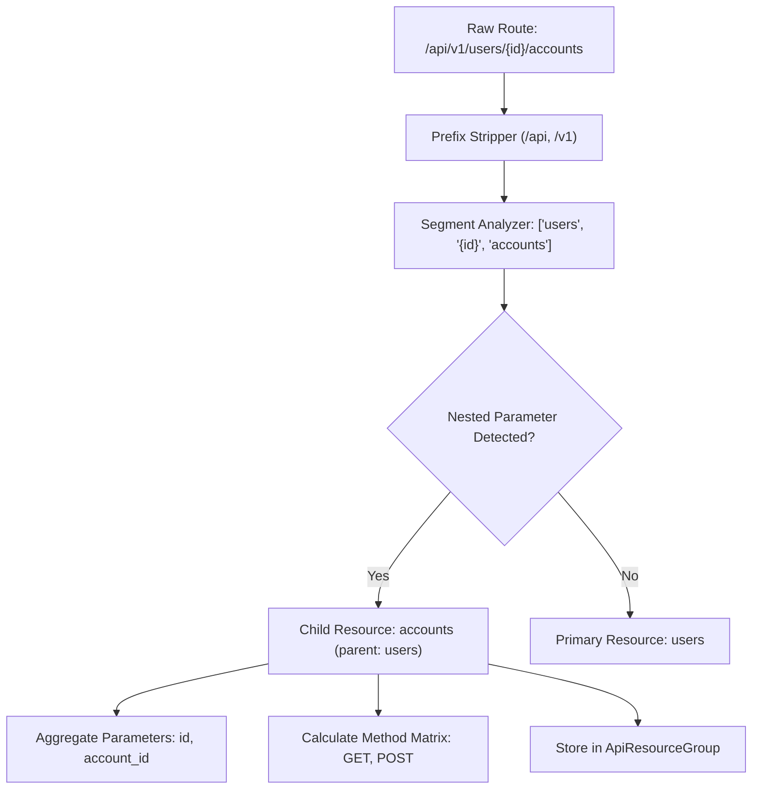

# Feature 3: API Inventory & Mapping — Resource Mapping Design

**Member 1: Application Intelligence**  
**Module:** PHANTOM-X Application Intelligence  
**Feature:** Feature 3 — API Inventory & Mapping  
**Date:** November 12, 2026  

---

## 1. Resource Modeling Philosophy

Modern REST APIs are structured around bounded business domain resources rather than individual endpoints. An attack surface consists of resources (e.g. `User`, `Account`, `Order`) that have CRUD capabilities and access boundaries.

Grouping endpoints into cohesive **Logical Resource Groups** provides:
1. **Attack Surface Comprehension**: Security operators immediately see which data domains are exposed.
2. **Authorization Boundary Detection**: Pinpoints whether sub-resources inherit or bypass parent resource permission models.
3. **Workflow Synthesis**: Enables autonomous testing engines to generate coherent resource lifecycles (Create -> Read -> Update -> Delete).

---

## 2. Path Normalization & Prefix Stripping

API routes frequently embed technology and versioning prefixes that obscure the underlying resource identity.

The `ResourceMapper` enforces strict prefix stripping using normalized segment patterns:
- Prefix Tokens Stripped:
  - Technology: `api`, `rest`, `v1`, `v2`, `v3`, `v1.0`, `v2.0`
- Normalization Process:
  1. Trim leading and trailing slashes.
  2. Split path by `/` into ordered tokens.
  3. Filter out leading prefix tokens until a domain segment is encountered.

### Prefix Stripping Examples:
| Raw Discovered Path | Normalized Semantic Segments | Primary Resource |
| :--- | :--- | :--- |
| `/api/v1/users` | `["users"]` | `users` |
| `/rest/v2/accounts/{id}/balance` | `["accounts", "{id}", "balance"]` | `accounts` |
| `/v1/auth/login` | `["auth", "login"]` | `login` (parent: `auth`) |
| `/organizations/{org_id}/members` | `["organizations", "{org_id}", "members"]` | `members` (parent: `organizations`) |

---

## 3. Parent-Child Entity Hierarchy

When routes contain nested path parameters followed by additional noun segments, the system identifies hierarchical relationships:

```
[organizations] (Top-Level Resource)
   │
   └── [members] (Child Sub-Resource)
   │      └── GET /organizations/{id}/members
   │      └── POST /organizations/{id}/members
   │
   └── [billing] (Child Sub-Resource)
          └── GET /organizations/{id}/billing
```

### Hierarchy Rules:
1. **Top-Level Resource**: When a single semantic noun segment exists (or noun + parameter), the entity is classified as top-level with `parent_resource=null`.
2. **Sub-Resource**: When a path has the structure `/{parent}/{parent_id}/{child}`, the child segment is classified as a sub-resource with `parent_resource=parent`.
3. **Sub-Resource Aggregation**: The parent resource's `related_resources` array automatically records all child sub-resources for bi-directional traversal.

---

## 4. Entity Aggregation & Coverage

For each logical resource group, `ResourceMapper` calculates:
1. **CRUD Method Matrix**: Tracks the presence of `GET` (Read/List), `POST` (Create/Action), `PUT`/`PATCH` (Update), and `DELETE` (Remove).
2. **Parameter Aggregation**: Consolidates path, query, and header parameters across all member routes.
3. **Schema Linking**: Maps request body schemas and response payload models to the resource definition.
4. **Confidence & Evidence**: Scores the extraction confidence (1.0 for documented specs, 0.85 for observed traffic) and records the evidence string.



