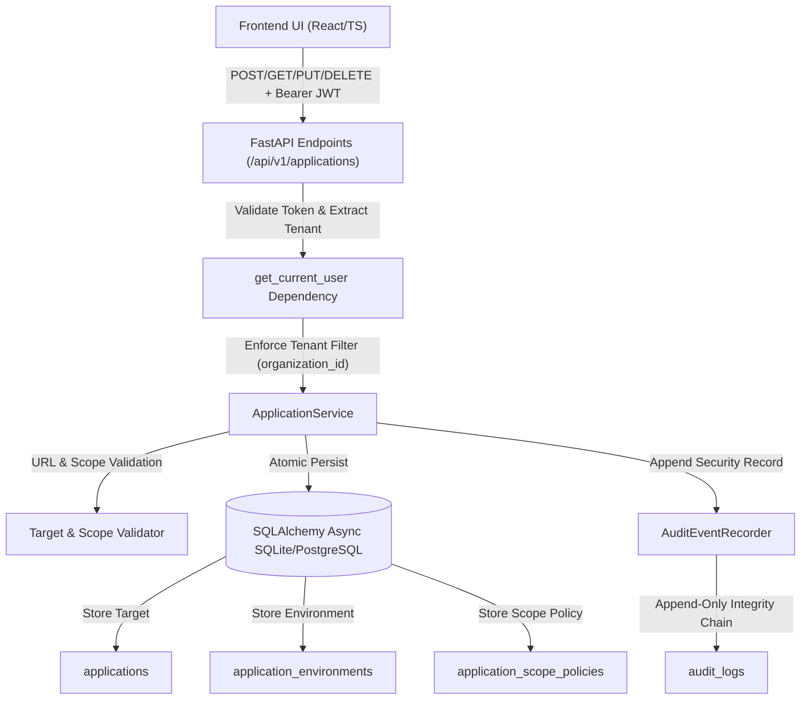

# Member 1 — Feature 1: Application Registration | Implementation Report

## 1. Executive Summary

- **Feature**: Application Registration (Member 1: Application Intelligence)
- **Module**: Application Intelligence & Asset Discovery
- **Status**: Production-Ready / Fully Verified
- **Date**: November 12, 2026

Feature 1 establishes the foundational asset profiling, boundary definition, and authorized scope management mechanism for the PHANTOM-X platform. It enables multi-tenant organizations to register, inspect, update, and manage target web applications and APIs. Crucially, it introduces strict testing authorization certification, prevents arbitrary organization binding, derives safe boundary policies, and preserves immutable audit logging without prematurely triggering offensive scans.

---

## 2. Architecture & Data Flow

### Key Architectural Tenets
1. **Multi-Tenant Isolation by Construction**: All database operations query strictly through `organization_id == current_user.organization_id`. Cross-tenant requests produce HTTP 404 responses to eliminate enumeration side-channels.
2. **Atomic Registration Lifecycle**: When an application is created, its corresponding `ApplicationEnvironment` (e.g., `production`, `staging`, `development`, `sandbox`) and `ApplicationScopePolicy` are created in a single atomic database transaction.
3. **Formal Authorization Enforcement**: Testing authorization must be explicitly confirmed (`confirm_authorization=True` and client affirmation). Scope cannot be marked active or authorized without affirmative consent.
4. **Decoupled Boundary Provisioning**: Registration establishes boundary metadata (`permitted_paths`, `excluded_paths`, `allowed_methods`, `max_requests_per_second`, `safe_mode_enabled`) which subsequent modules (Feature 2 Discovery, Member 2 Attack Engine) ingest without scanning during registration.

---

## 3. Detailed File Implementation & Changes

### A. Backend Core & Service Layer
- **`backend/app/services/application_service.py`**:
  - `validate_target_url(target_url: str)`: Enforces RFC compliance using `urllib.parse.urlsplit`/`urlparse`. Mandates `http` or `https` schemes, non-empty hostnames, valid character syntax, and numeric port range constraints (1–65535). Normalizes target URLs to prevent slash-bypass variances.
  - `validate_scope_paths(permitted_paths, excluded_paths)`: Validates path patterns, normalizes leading slashes, and defaults permitted paths to `["/*"]` if unspecified.
  - `validate_allowed_methods(allowed_methods)`: Enforces that testing methods strictly belong to standard HTTP methods (`GET`, `POST`, `PUT`, `PATCH`, `DELETE`, `HEAD`, `OPTIONS`).
  - `_resolve_scope_status(scope_policy)`: Dynamically checks `valid_until_utc`. If authorization validity has elapsed (`now > valid_until_utc`), dynamically overrides status to `EXPIRED` for both scope and authorization status.
  - `register_application()`: Validates target URL, scope, and explicit authorization confirmation. Checks for name collisions within the same tenant. Atomically registers `Application`, `ApplicationEnvironment`, and `ApplicationScopePolicy`. Emits an audit event via `AuditEventRecorder`.
  - `list_applications()`: Queries database with `organization_id == current_user.organization_id`, with optional case-insensitive search and status filtering, ordered chronologically.
  - `get_application()`: Retrieves target with joined environments and scope policies under strict tenant isolation.
  - `update_application()`: Updates application metadata, environment, and scope policies atomically, re-validating URLs and methods.
  - `delete_application()`: Cascades deletion of environments and scope policies while preserving immutable audit logs.
  - `get_application_scope()`: Dedicated endpoint for downstream discovery engines.

- **`backend/app/services/__init__.py`**:
  - Exported `ApplicationService`.

### B. Backend API Endpoints
- **`backend/app/api/v1/endpoints/applications.py`**:
  - Replaced mock stubs and unauthenticated handlers with secure async FastAPI endpoints:
    - `POST /api/v1/applications/` (201 Created)
    - `GET /api/v1/applications/` (200 OK)
    - `GET /api/v1/applications/{application_id}` (200 OK)
    - `PUT /api/v1/applications/{application_id}` (200 OK)
    - `PATCH /api/v1/applications/{application_id}` (200 OK)
    - `DELETE /api/v1/applications/{application_id}` (204 No Content)
    - `GET /api/v1/applications/{application_id}/scope` (200 OK)
  - All routes protected by `current_user: User = Depends(get_current_user)`.

### C. Database Models & Schema Relationships
- **`backend/app/models/application.py`**:
  - Added explicit bidirectional relationship `scope_policy` pointing to `ApplicationScopePolicy` with `cascade="all, delete-orphan"`, `uselist=False`, and `lazy="selectin"`.
- **`backend/app/models/scope_safety.py`**:
  - Updated `application` relationship with `back_populates="scope_policy"` to maintain ORM consistency.
- Database tables utilized: `applications`, `application_environments`, `application_scope_policies`, `audit_logs`.

### D. Shared Contracts & Types
- **`shared/contracts/models.py` & `shared/contracts/__init__.py`**:
  - Added `ApplicationScopeDetail` schema.
  - Expanded `ApplicationCreate` with `environment_name`, `permitted_paths`, `excluded_paths`, `allowed_methods`, `max_requests_per_second`, `safe_mode_enabled`, and `confirm_authorization`.
  - Expanded `ApplicationUpdate` with optional target URL, environment, and scope policy limits.
  - Added `scope: Optional[ApplicationScopeDetail]` and `environment_name: Optional[str]` to `ApplicationResponse`.

### E. Frontend Components & Pages
- **`frontend/src/types/index.ts`**:
  - Added `ApplicationScopeDetail` and synchronized `Application`, `ApplicationCreate`, `ApplicationUpdate`, and `ApplicationResponse` interfaces.
- **`frontend/src/services/api.ts`**:
  - Added `applications.update`, `applications.getScope`, and query parameters (`search`, `status`) to `applications.list`.
- **`frontend/src/components/applications/`**:
  - `ApplicationRegistrationModal.tsx`: Complete registration dialog with multi-field validation, environment selector, scope controls, and mandatory authorization confirmation checkbox.
  - `ApplicationEditModal.tsx`: Modal for modifying application profiling, target URL, and scope policy limits.
  - `ApplicationDeleteDialog.tsx`: Confirmation modal with destructive warning and target confirmation.
  - `ApplicationCard.tsx`: Cyber-styled card showing application health, environment badge, authorization status badge, RPS cap, and direct action triggers.
  - `index.ts`: Barrel export.
- **`frontend/src/pages/ApplicationsPage.tsx`**:
  - Full-featured application inventory page with live search, status filter tabs (`ALL`, `ACTIVE`, `INACTIVE`), modal triggers, real-time error banners, loading spinners, and empty states.
  - Zero mock/fallback data.
- **`frontend/src/pages/ApplicationDetailsPage.tsx`**:
  - Comprehensive asset inspection page displaying target metadata, environment tier, real-time authorization status badge, authorized testing scope limits, and navigation links.
  - Removed dummy fallback dictionaries.
- **`frontend/tests/setup.ts`**:
  - Added safe `localStorage` mock for Node 22+ JSDOM runner compatibility.

---

## 4. Security Verification

| Security Requirement | Implementation Mechanism | Verification Status |
| :--- | :--- | :--- |
| **Authentication Enforcement** | All endpoints enforce FastAPI `get_current_user` JWT validation; returns 401 if missing/invalid. | Verified (`test_12`) |
| **Tenant Isolation** | Database queries filter by `organization_id == current_user.organization_id`. Foreign tenant access returns 404. | Verified (`test_13`) |
| **No Hardcoded Org IDs** | Organization is extracted strictly from the authenticated JWT token payload. | Verified (`test_01`, `test_13`) |
| **Target URL Validation** | Scheme must be `http`/`https`; host must be valid; ports must be 1–65535; scheme bypasses rejected. | Verified (`test_03`) |
| **Explicit Authorization** | Requires `confirm_authorization=True` and affirmative user certification; rejects unconfirmed with 400. | Verified (`test_04`) |
| **Scope Boundary Confinement**| Allowed methods restricted to HTTP standard; target domains derived from URL; excluded paths preserved. | Verified (`test_05`, `test_09`) |
| **No Premature Scanning** | Application registration is strictly a boundary configuration step; no scan jobs or probes dispatched. | Verified (`test_01`, `test_09`) |
| **Audit Logging & Chaining** | Operations emit structured records to `audit_logs` using HMAC-chained sequence numbers. | Verified (`test_01`, `test_10`, `test_11`) |
| **Audit Preservation on Delete**| Deleting an application cascades environments/scope policies, but preserves `audit_logs` permanently. | Verified (`test_11`) |

---

## 5. Remaining Limitations & Future Integration

1. **Active Domain Ownership Verification**: Testing authorization is currently established via explicit user affirmation. A cryptographic challenge (such as DNS TXT record or `.well-known/phantom-security.txt` verification) could be added in future iterations for external domains.
2. **SSRF Guardrails for Scan Execution**: Target validation restricts scheme and host syntax, but resolving private IP ranges (e.g. AWS metadata `169.254.169.254`, `10.0.0.0/8`, `127.0.0.1`) should be enforced at the runtime scanner layer prior to HTTP dispatch in Member 1 Feature 2 (Discovery) and Member 2 (Attacks).
3. **Dynamic Scope Expiry Handling**: Scope expiration is verified dynamically upon retrieval; a scheduled background cron could periodically mark expired records in batch.

