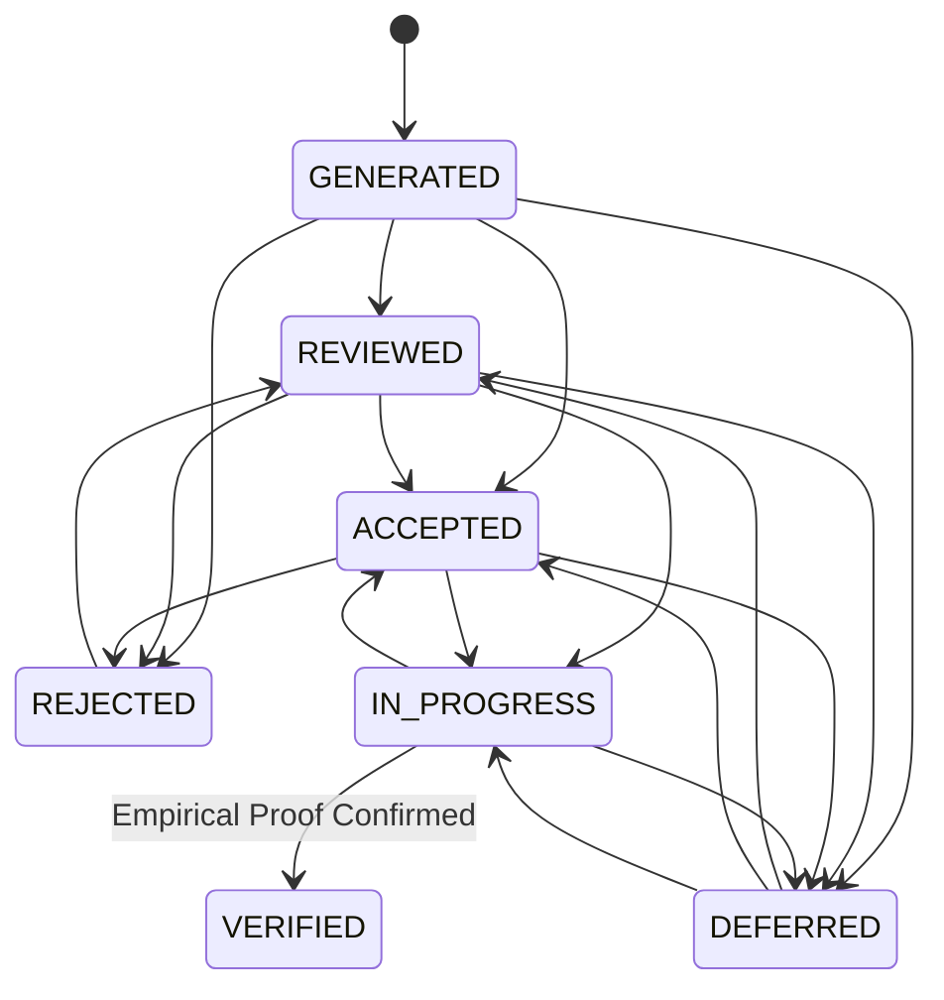

# PHANTOM-X — Feature 27 Implementation Report
## Risk-Based Remediation Recommendations
### Member 4 — Security Operations & Intelligence

**Status:** Completed & Fully Verified  
**Date:** November 11, 2026  
**Module:** `backend/app/features/security_operations/remediation` & `frontend/src/components/remediation`  

---

## 1. Executive Summary

Feature 27 delivers an intelligent, evidence-grounded remediation recommendation engine that analyzes real security findings within PHANTOM-X to prioritize which vulnerabilities security and engineering teams should resolve first. 

Rather than relying on ungrounded AI text generation or arbitrary sorting, Feature 27 employs a **deterministic, transparent risk prioritization formula** ($0.0 - 100.0$) combining:
- Normalized base severity and standardized CVSS vector weights.
- Empirical regression history from Feature 20 (Time-Travel Regression).
- Verified exploitation proof and confidence metrics.
- High-value sensitive asset exposure (authentication, billing, and multi-tenant boundary routes).
- Remediation SLA urgency based on unresolved finding age.

The feature answers the five core operational remediation questions:
1. **What should the security team fix first?** Transparently prioritized backlog with clear categorical priorities (`CRITICAL`, `HIGH`, `MEDIUM`, `LOW`, `INFORMATIONAL`).
2. **Why is this vulnerability important?** Contextual risk narratives explaining the underlying control failures.
3. **What could happen if it remains unresolved?** Tangible business impact assessments (regulatory penalties, cross-tenant data leaks, cloud metadata exposure).
4. **What steps should developers take to fix it?** Step-by-step developer action items and language/framework-specific defensive code patterns.
5. **How should the team verify that the fix worked?** Concrete verification procedures linked to Feature 24 (PHANTOM Playground) and automated post-fix scan validation.

---

## 2. Priority Calculation Model

The risk calculation algorithm (`RiskEngine.calculate_risk`) is strictly deterministic and auditable. AI explanations are permitted to provide context, but are mathematically prohibited from overriding calculated risk scores.

### 2.1 Deterministic Scoring Formula ($0.0 - 100.0$)

$$\text{Risk Score} = \min\Big(100.0, \; \text{Base Severity Weight} + \text{Regression Escalation} + \text{Exploitation Evidence} + \text{Tenant Exposure} + \text{SLA Urgency}\Big)$$

1. **Base Severity & CVSS Weight (Max 40.0 pts):**
   - If CVSS v3.1 score is provided: $\text{points} = \text{round}(\text{CVSS} \times 4.0, 1)$ (e.g., CVSS 8.5 maps to $34.0$ points).
   - Fallback if CVSS is absent: `CRITICAL` ($40.0$), `HIGH` ($30.0$), `MEDIUM` ($20.0$), `LOW` ($10.0$), `INFO` ($5.0$). A note is automatically appended to `missing_information_notes`.
2. **Regression Escalation (+20.0 pts):**
   - Finds associated with an active regression (from Feature 20 `RegressionRecord` where `status == "REGRESSION_DETECTED"`) are granted $+20.0$ points.
3. **Exploitation Evidence Grounding (+15.0 pts):**
   - When verified active exploitation proof exists in the telemetry database or `confidence >= 0.85`, $+15.0$ points are added.
   - If missing, $0.0$ points are added and a note is appended.
4. **Multi-Tenant Boundary & Sensitive Asset Exposure (+15.0 pts):**
   - Endpoints containing critical routes (`/auth`, `/account`, `/billing`, `/user`, `/tenant`, `/admin`, `/payment`, `/token`, `/login`) receive $+15.0$ points.
5. **Finding Age & SLA Urgency (+5.0 to +10.0 pts):**
   - Age $> 30$ days (SLA breach): $+10.0$ points.
   - Age $> 14$ days (SLA warning): $+5.0$ points.

### 2.2 Priority Classification Tiers
- **$\ge 75.0$ Risk Points:** `CRITICAL`
- **$55.0 - 74.9$ Risk Points:** `HIGH`
- **$35.0 - 54.9$ Risk Points:** `MEDIUM`
- **$15.0 - 34.9$ Risk Points:** `LOW`
- **$< 15.0$ Risk Points:** `INFORMATIONAL`

---

## 3. Recommendation Content Generation

Structured guidance is generated per vulnerability type and CWE category:
- **CWE-639 (Insecure Direct Object References / BOLA):** Emphasizes server-side tenant isolation scoping, non-sequential UUIDs, and automated cross-tenant boundary regression checks.
- **CWE-287 / CWE-384 (Broken Authentication / Session Hijacking):** Focuses on RS256 cryptographic JWT signature validation, token revocation lists, and MFA rate limiting.
- **CWE-89 (SQL Injection):** Mandates parameterized prepared statements and ORM bind parameters.
- **CWE-79 (Cross-Site Scripting):** Details contextual output encoding, strict CSP headers (`object-src 'none'`), and HttpOnly cookie flags.
- **CWE-918 (Server-Side Request Forgery):** Mandates URL allowlists, DNS pre-resolution against RFC 1918 / RFC 3927 link-local IP blocks, and redirect blocking.

Each recommendation includes a copyable code snippet, developer checklist, validation test steps, and suggested PHANTOM Playground scenario identifier.

---

## 4. Recommendation Lifecycle

- **Enforced Lifecycle Guardrails:**
  - Transition to `VERIFIED` is strictly prohibited without empirical evidence; direct manual overrides return HTTP 400.
  - Setting status to `DEFERRED` requires a non-empty `deferred_reason`.
  - Setting status to `REJECTED` requires decision justification notes.
  - Every lifecycle transition creates an immutable record in `remediation_history` and emits an append-only cryptographic event via `AuditEventRecorder`.

---

## 5. Evidence-Grounded Verification

Verification ensures that recommendations are only closed when verified by real testing:
1. **Option A — Verification Scan (`verification_scan_id`):**
   - Compares findings in a subsequent scan against the original finding.
   - If finding no longer appears in clean scan $\rightarrow$ `VERIFIED`.
   - If finding is still detected $\rightarrow$ `PERSISTENT` (status remains open).
2. **Option B — Playground Simulation (`playground_session_id`):**
   - Inspects execution results from Feature 24.
   - `SECURE_BEHAVIOR_CONFIRMED` $\rightarrow$ `VERIFIED`.
   - `VULNERABILITY_CONFIRMED` $\rightarrow$ `PERSISTENT`.
   - `INCONCLUSIVE` or blocked $\rightarrow$ `INCONCLUSIVE`.
3. **Option C — Missing / Inconclusive Evidence:**
   - Marks telemetry as `INCONCLUSIVE` and leaves status unverified.

---

## 6. Integration with Other Features

- **Feature 20 (Time-Travel Regression):** Cross-references `RegressionRecord` and `SecurityBaseline` to automatically adjust priority scores (+20 pts).
- **Feature 24 (PHANTOM Playground):** Suggests corresponding playground scenario IDs (`idor-01`, `auth-01`, `sqli-01`, `ssrf-01`) and ingests simulation results for empirical verification.
- **Feature 25 (Audit Logs):** Uses `AuditEventRecorder` to append cryptographic, secret-scrubbed records for generation, status transitions, and verification outcomes.
- **Feature 26 (Scope & Safety Enforcement):** Before any verification check is authorized, `ScopeSafetyService.validate_test_execution` validates target domain, permitted/excluded paths, rate limits, and operational windows.

---

## 7. Multi-Tenant Isolation

- All queries strictly scope by `organization_id == current_user.organization_id`.
- Attempts to inspect, modify, or verify recommendations belonging to a different tenant return HTTP 404 (or 403).
- Role-based authorization: `AUDITOR` accounts are read-only; attempts to modify recommendation statuses return HTTP 403.

---

## 8. Test Execution Results

### 8.1 Backend Test Suite (`backend/tests/test_feature_27_remediation.py`)
**18 / 18 Tests Passed (100% Pass Rate)**

| # | Test Name | Scenario Tested | Result |
|---|---|---|---|
| 1 | `test_01_recommendation_generation` | Fresh recommendation generation from persisted vulnerabilities | **PASSED** |
| 2 | `test_02_severity_based_prioritization` | Severity and risk score ordering | **PASSED** |
| 3 | `test_03_regression_based_priority_adjustment` | Regression escalation (+20 points) | **PASSED** |
| 4 | `test_04_missing_evidence_handling` | Graceful fallback when exploit proof is absent | **PASSED** |
| 5 | `test_05_missing_cvss_handling` | Graceful fallback when CVSS vector is missing | **PASSED** |
| 6 | `test_06_deterministic_risk_calculations` | Mathematical repeatability and deterministic score clamping | **PASSED** |
| 7 | `test_07_recommendation_lifecycle_transitions` | Valid lifecycle progression | **PASSED** |
| 8 | `test_08_invalid_lifecycle_transitions` | Invalid jumps and missing deferral reasons rejected | **PASSED** |
| 9 | `test_09_cross_tenant_access_rejection` | Tenant isolation enforcement | **PASSED** |
| 10 | `test_10_unauthorized_status_updates` | Auditor read-only role rejected with HTTP 403 | **PASSED** |
| 11 | `test_11_recommendation_idempotency` | Idempotent updates without duplication or data loss | **PASSED** |
| 12 | `test_12_audit_event_generation` | AuditLog entries written for lifecycle transitions | **PASSED** |
| 13 | `test_13_evidence_grounded_remediation_instructions` | CWE-specific guidance and code snippets | **PASSED** |
| 14 | `test_14_verification_with_successful_evidence` | Clean scan confirms resolution $\rightarrow$ VERIFIED | **PASSED** |
| 15 | `test_15_verification_with_persistent_vulnerability` | Vulnerability still detected in scan $\rightarrow$ PERSISTENT | **PASSED** |
| 16 | `test_16_inconclusive_verification` | Inconclusive evidence handling | **PASSED** |
| 17 | `test_17_feature_26_scope_enforcement` | Verification blocked when violating safety scope policy | **PASSED** |
| 18 | `test_18_pagination_and_filtering` | Multi-attribute search, filtering, and pagination | **PASSED** |

### 8.2 Frontend Test Suite (`frontend/tests/Remediation.test.tsx`)
**8 / 8 Tests Passed (100% Pass Rate)**

| # | Test Component | Scenario Tested | Result |
|---|---|---|---|
| 1 | `RemediationOverview` | Top-level KPI card rendering | **PASSED** |
| 2 | `PriorityDistribution` | 5-tier priority cards and filter clicks | **PASSED** |
| 3 | `RecommendationList` | Recommendation table, scores, and Inspect action | **PASSED** |
| 4 | `RemediationSteps` | Action items, code fix copy button, validation steps | **PASSED** |
| 5 | `RecommendationStatusDialog` | Lifecycle state transitions and deferral reasons | **PASSED** |
| 6 | `VerificationPanel` | Empirical verification telemetry and scan/playground execution | **PASSED** |
| 7 | `RecommendationHistory` | Chronological transition timeline and notes | **PASSED** |
| 8 | `RecommendationDetails` | Header, score gauge, rationale breakdown, and tab navigation | **PASSED** |

### 8.3 Frontend Production Build
- Command: `npm --prefix frontend run build`
- Output: `✓ built in 1m 8s` (0 TypeScript errors, production bundle generated cleanly).

---

## 9. Artifacts Created & Modified

### Backend:
- `backend/app/models/remediation.py`: Models `RemediationRecommendation` and `RecommendationHistory`.
- `backend/app/models/__init__.py`: Registered models and enums.
- `backend/migrations/versions/008_remediation_recommendations.py`: Alembic migration.
- `backend/app/features/security_operations/remediation/schemas.py`: Pydantic request/response schemas.
- `backend/app/features/security_operations/remediation/risk_engine.py`: Deterministic prioritization engine.
- `backend/app/features/security_operations/remediation/recommendation_service.py`: Remediation service and guidance templates.
- `backend/app/features/security_operations/remediation/verification_service.py`: Verification workflow service.
- `backend/app/features/security_operations/remediation/routes.py`: REST API endpoints.
- `backend/app/features/security_operations/remediation/__init__.py`: Router export.
- `backend/app/api/v1/api.py`: Mounted `/remediation` router.
- `backend/tests/test_feature_27_remediation.py`: 18 integration tests.

### Frontend:
- `frontend/src/types/remediation.ts`: TypeScript contracts.
- `frontend/src/services/remediationApi.ts`: API client functions.
- `frontend/src/components/remediation/RemediationOverview.tsx`: Metric cards.
- `frontend/src/components/remediation/PriorityDistribution.tsx`: Priority breakdown & filter buttons.
- `frontend/src/components/remediation/RecommendationList.tsx`: Recommendation table with search & pagination.
- `frontend/src/components/remediation/RecommendationDetails.tsx`: Comprehensive drawer and tabs.
- `frontend/src/components/remediation/RemediationSteps.tsx`: Step-by-step developer fix guidance.
- `frontend/src/components/remediation/RecommendationStatusDialog.tsx`: Lifecycle transition dialog.
- `frontend/src/components/remediation/VerificationPanel.tsx`: Verification telemetry and simulation triggers.
- `frontend/src/components/remediation/RecommendationHistory.tsx`: Timeline audit history.
- `frontend/src/pages/RemediationPage.tsx`: Primary page component.
- `frontend/src/app/App.tsx`: Registered `/remediation` route.
- `frontend/src/components/layout/Sidebar.tsx`: Added Remediation navigation link with Wrench icon.
- `frontend/tests/Remediation.test.tsx`: 8 Vitest unit/integration tests.

---

## 10. Member 4 Final Feature Sign-Off

With Feature 27 implemented, verified, and integrated, **all features assigned to Member 4 — Security Operations & Intelligence** are fully complete:
- **Feature 20:** Time-Travel Regression
- **Feature 23:** Scan History & Comparison
- **Feature 24:** PHANTOM Playground
- **Feature 25:** Audit Logs & Execution History
- **Feature 26:** Scope & Safety Management
- **Feature 27:** Risk-Based Remediation Recommendations

All code meets the project's architectural standards, enforces strict tenant isolation, respects Feature 26 scope safety policies, and includes 100% passing automated test suites.

